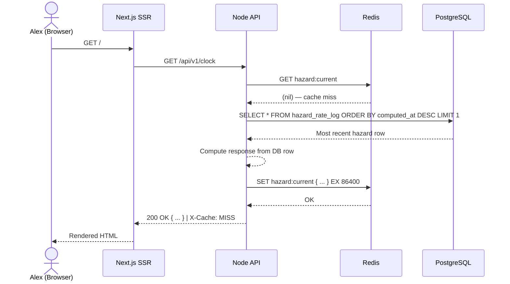
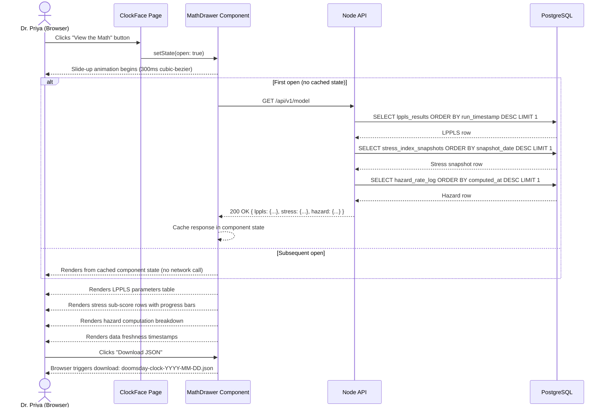
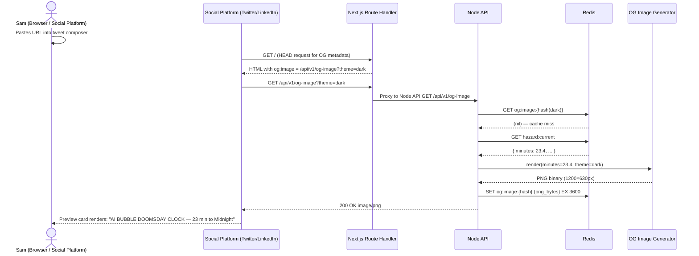
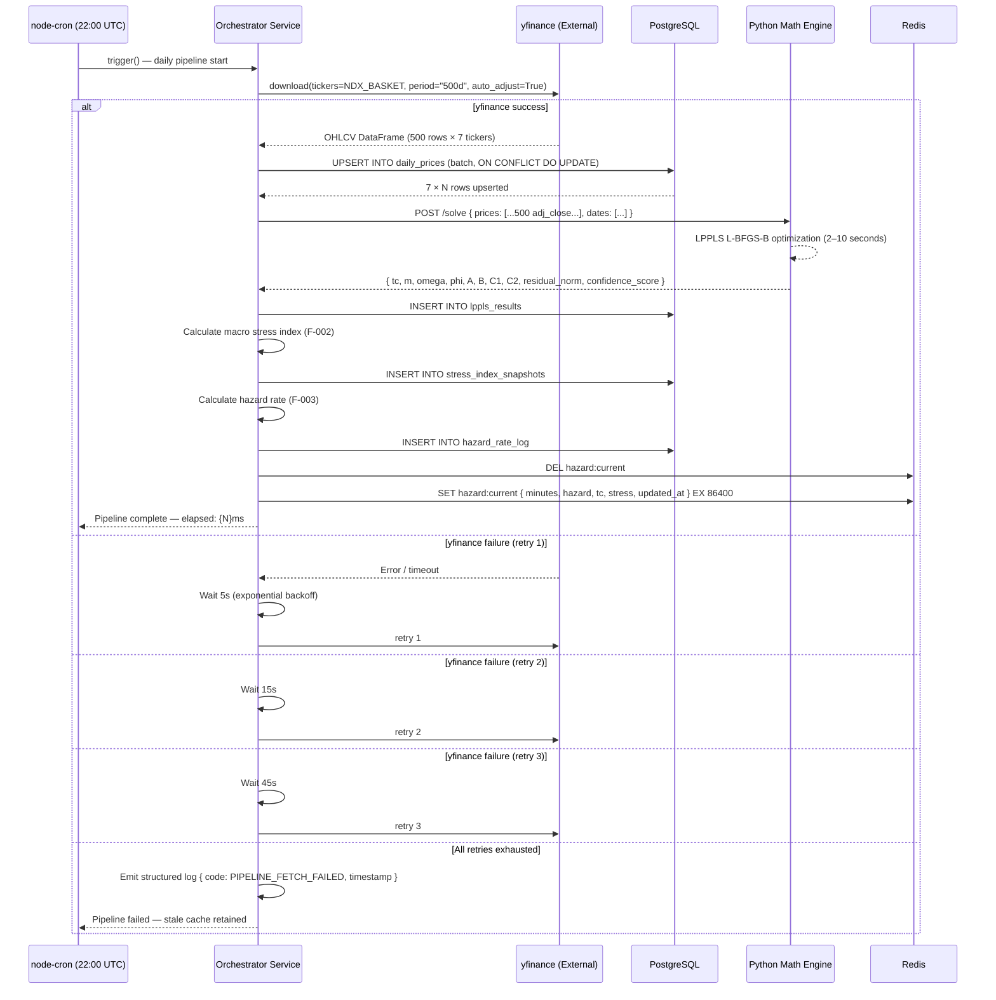
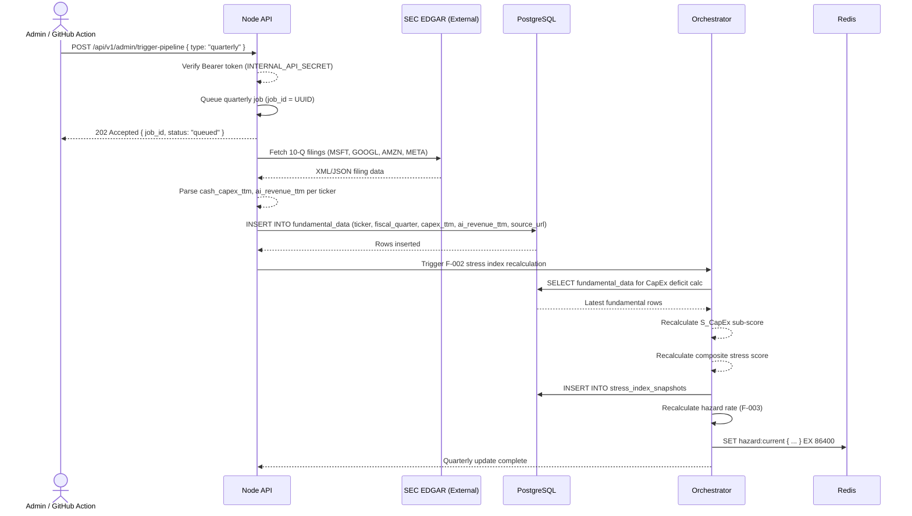
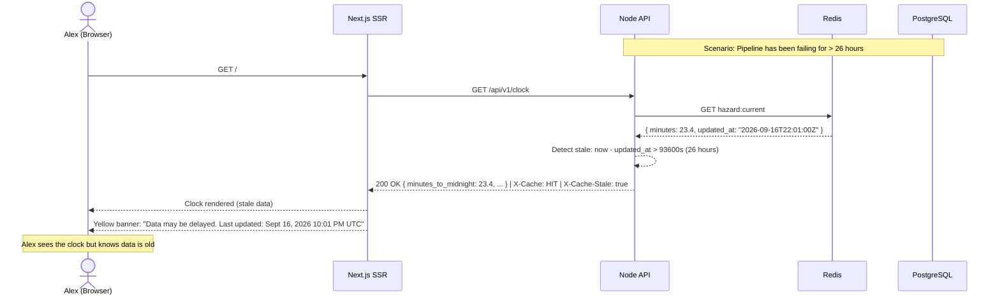
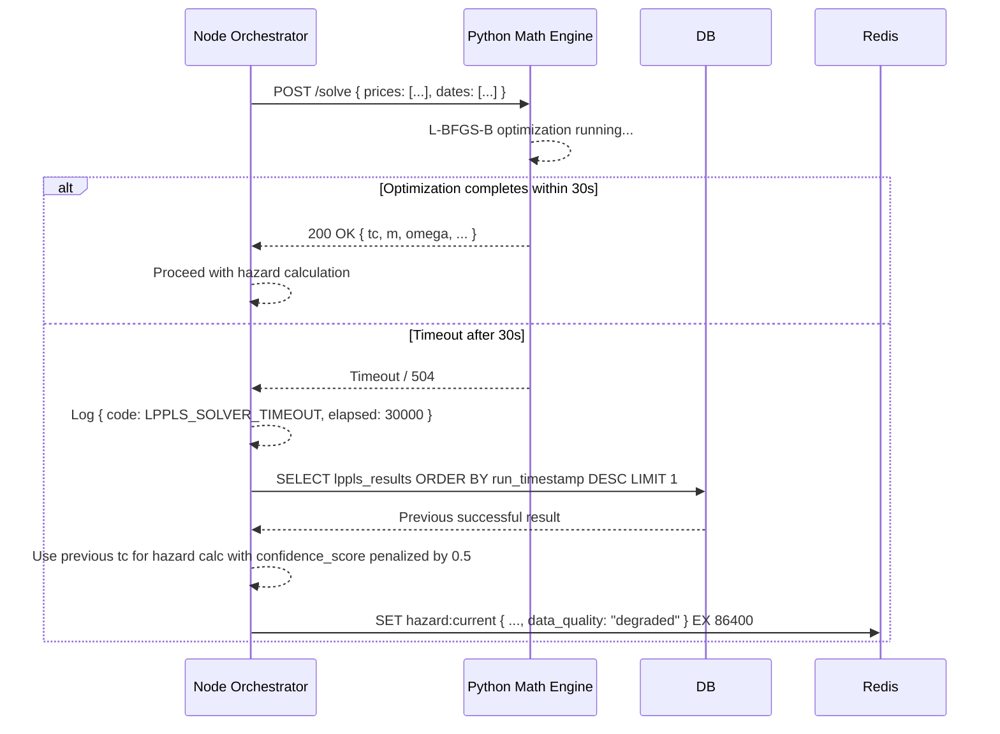

# User Flows
### AI Bubble Doomsday Clock

> **Document status**: Approved — Source of Truth
> **Version**: 1.0.0
> **Last updated**: 2026-09-17

All sequence diagrams use Mermaid syntax. Legend: solid arrows = request/trigger, dashed arrows = response/return.

---

## Flow 1 — First-Time Visitor Landing (Cache Hit)

The critical render path. This must complete within 3 seconds on a standard 4G connection.

```mermaid
sequenceDiagram
    actor Alex as Alex (Browser)
    participant CDN as CDN / Edge Cache
    participant Web as Next.js SSR (Port 3000)
    participant API as Node API (Port 3001)
    participant Redis as Redis (Port 6379)

    Alex->>CDN: GET https://aibubbleclock.com/
    CDN-->>CDN: Check edge cache (miss for SSR)
    CDN->>Web: Forward request
    Web->>API: GET /api/v1/clock
    API->>Redis: GET hazard:current
    Redis-->>API: { minutes: 23.4, hazard: 0.71, tc_date: "2027-03-12", stress_score: 68.2, updated_at: "..." }
    API-->>Web: 200 OK { minutes_to_midnight: 23.4, ... } | X-Cache: HIT
    Web-->>Web: generateMetadata() — inject og:title, og:image URL
    Web-->>CDN: HTML with server-rendered clock initial state
    CDN-->>Alex: HTML (First Contentful Paint)
    Alex->>Alex: Hydrate React; ClockFace renders with SVG hand at 23.4 min
    Alex->>Alex: SWR begins 30-second polling cycle
```

**Key constraints**:
- Redis cache hit path: `API → Redis → API` must complete in < 5ms
- Next.js SSR render + HTML send: < 200ms
- Full page hydration (Largest Contentful Paint): < 3s on 4G

---

## Flow 2 — First-Time Visitor Landing (Cache Miss)

Occurs immediately after pipeline runs and cache is invalidated, or on first boot.



**Note**: This flow is rare. The pipeline always pre-populates Redis before any traffic surge.

---

## Flow 3 — "View the Math" Drawer Interaction



---

## Flow 4 — Social Share OG Image Flow



---

## Flow 5 — Daily Automated Data Pipeline

The fully automated end-to-end pipeline. No human interaction required.



---

## Flow 6 — Quarterly Fundamental Data Update



---

## Flow 7 — Error & Graceful Degradation Path



---

## Flow 8 — Python Engine Timeout Handling



---

*See also*: [docs/03-user-stories.md](03-user-stories.md) | [docs/05-architecture.md](05-architecture.md) | [docs/07-api-specification.md](07-api-specification.md)
