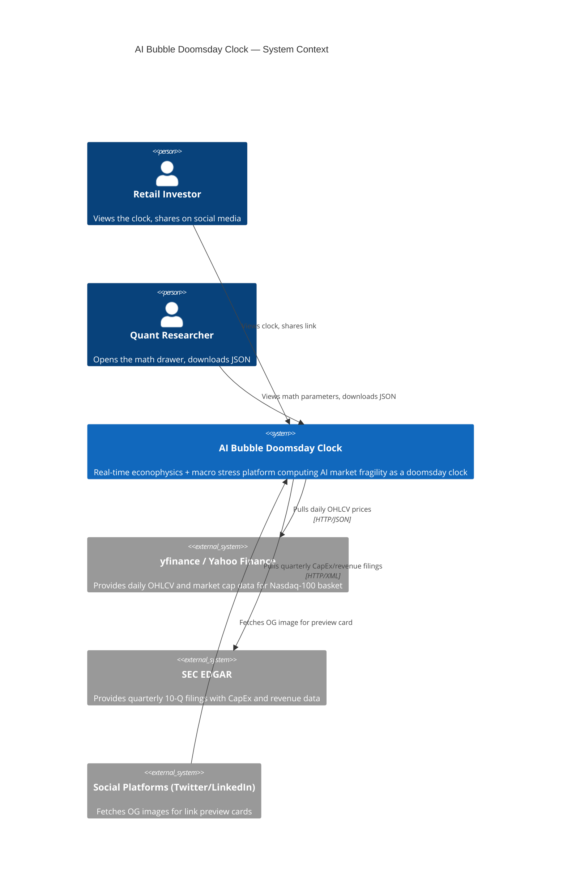
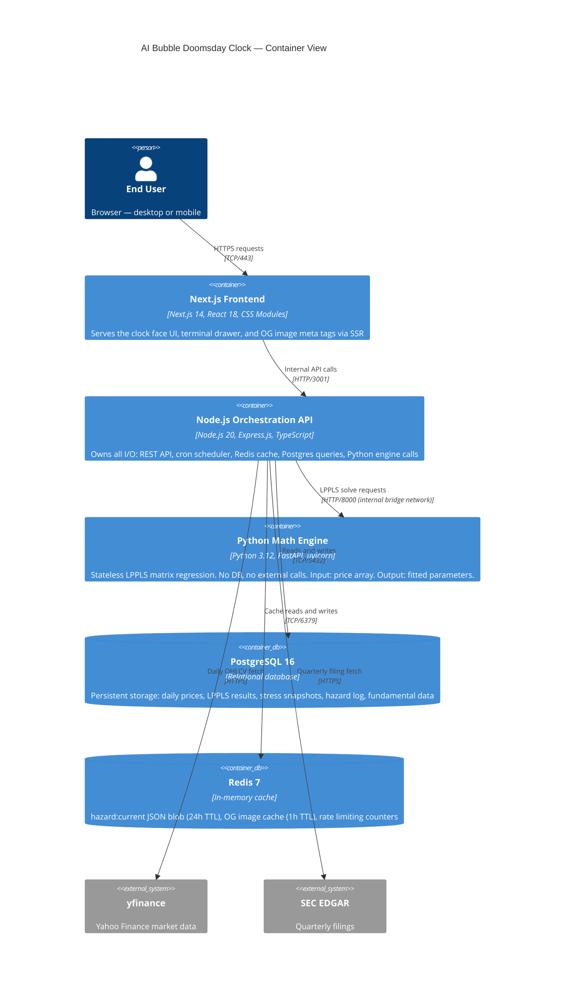
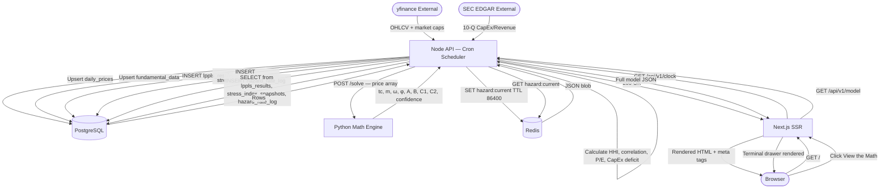

# System Architecture
### AI Bubble Doomsday Clock

> **Document status**: Approved — Source of Truth
> **Version**: 1.0.0
> **Last updated**: 2026-09-17

---

## 1. Architecture Overview

The AI Bubble Doomsday Clock uses a **hard-decoupled microservice architecture** with a strict boundary between mathematical computation and I/O orchestration. This design is motivated by a fundamental incompatibility: the Python scientific ecosystem (NumPy, SciPy) provides irreplaceable matrix optimization primitives, while Node.js provides a superior non-blocking event loop for managing concurrent I/O, cron scheduling, and REST API serving.

The system is composed of five containers, communicating exclusively over an internal Docker bridge network. No service has direct access to another service's data store. The Python math engine is **stateless by architectural constraint** — it accepts a price array and returns parameters. It never opens a database connection.

---

## 2. C4 Context Diagram



---

## 3. C4 Container Diagram



---

## 4. Service Boundary Contracts

### 4.1 Python Math Engine

| Property | Value |
|----------|-------|
| **Container name** | `python-engine` |
| **Runtime** | Python 3.12, uvicorn + FastAPI |
| **Internal port** | 8000 |
| **External exposure** | None — internal Docker network only |
| **State** | Stateless. Zero disk writes during operation |
| **Memory limit** | 512 MB |
| **CPU limit** | 1 vCPU |
| **Startup time** | < 3 seconds |
| **Health endpoint** | `GET /health` → `{ status: "ok", solver: "lbfgsb" }` |

**Input contract** — `POST /solve`:
```json
{
  "prices": [number],   // 100–2000 adjusted closing prices, chronological
  "dates":  [string]    // ISO-8601 date strings (same length as prices)
}
```

**Output contract** — `POST /solve` response:
```json
{
  "tc":               number,  // decimal year, e.g. 2027.43
  "m":                number,  // [0.1, 0.9]
  "omega":            number,  // [4.0, 25.0]
  "phi":              number,  // [0, 2π)
  "A":                number,  // > 0
  "B":                number,  // < 0
  "C1":               number,  // B·cos(phi)
  "C2":               number,  // B·sin(phi)
  "residual_norm":    number,  // L2 norm of residuals
  "confidence_score": number   // [0, 1]
}
```

**Forbidden operations** (enforced in CI via custom linter rule):
- `import sqlalchemy`, `import psycopg2`, `import pymongo`, any DB driver
- `import requests`, `import httpx`, `import aiohttp`, any HTTP client
- `open()` file operations (beyond reading config)
- `datetime.now()`, `time.time()` in computation paths (non-deterministic)
- `random.random()` without explicit seeding

### 4.2 Node.js Orchestration API

| Property | Value |
|----------|-------|
| **Container name** | `api` |
| **Runtime** | Node.js 20 LTS, Express.js, TypeScript |
| **Internal port** | 3001 |
| **External exposure** | Port 3001 (reverse proxied by Nginx or Caddy) |
| **State** | Stateless (all state in Postgres + Redis) |
| **Memory limit** | 256 MB per instance |
| **CPU limit** | 1 vCPU per instance |
| **Health endpoint** | `GET /api/v1/health` |

**Exclusive ownership** — this service is the **sole** owner of:
- All PostgreSQL read/write operations
- Redis GET/SET/DEL operations
- External HTTP calls (yfinance, SEC EDGAR)
- Cron job scheduling and execution
- OG image generation
- Rate limiting enforcement

### 4.3 PostgreSQL 16

| Property | Value |
|----------|-------|
| **Container name** | `postgres` |
| **Port** | 5432 (internal only) |
| **Exposed to** | `api` container only |
| **Volume** | `postgres_data:/var/lib/postgresql/data` |
| **Max connections** | 100 (api uses connection pool of 10) |

### 4.4 Redis 7

| Property | Value |
|----------|-------|
| **Container name** | `redis` |
| **Port** | 6379 (internal only) |
| **Exposed to** | `api` container only |
| **Persistence** | AOF enabled (`appendonly yes`) |
| **Max memory** | 256 MB |
| **Eviction policy** | `allkeys-lru` |

---

## 5. End-to-End Data Flow



---

## 6. Infrastructure & Deployment

### 6.1 Docker Compose Service Definitions (Logical)

```
services:
  postgres:
    image: postgres:16-alpine
    volumes: [postgres_data]
    env: POSTGRES_DB, POSTGRES_USER, POSTGRES_PASSWORD
    healthcheck: pg_isready
    networks: [internal]

  redis:
    image: redis:7-alpine
    command: redis-server --appendonly yes --maxmemory 256mb --maxmemory-policy allkeys-lru
    volumes: [redis_data]
    networks: [internal]

  python-engine:
    build: ./services/python-engine
    env: PORT=8000, LOG_LEVEL=INFO
    depends_on: [postgres is NOT listed — intentionally stateless]
    networks: [internal]
    mem_limit: 512m
    cpus: 1.0
    healthcheck: GET /health

  api:
    build: ./services/api
    env: PORT=3001, DATABASE_URL, REDIS_URL, PYTHON_ENGINE_URL, CRON_ENABLED, INTERNAL_API_SECRET
    depends_on: [postgres, redis, python-engine]
    networks: [internal, external]
    mem_limit: 256m

  web:
    build: ./apps/web
    env: NEXT_PUBLIC_API_URL
    depends_on: [api]
    networks: [external]

networks:
  internal:  (bridge, not exposed to host)
  external:  (bridge, exposed to host/reverse proxy)
```

### 6.2 Network Topology

```
[Internet] ──► [Reverse Proxy: Nginx/Caddy :443] ──► [web :3000]
                                                  └──► [api :3001] (for direct API access)
[web] ──────────────────────────────────────────► [api :3001]       (internal bridge)
[api] ──────────────────────────────────────────► [python-engine :8000] (internal bridge)
[api] ──────────────────────────────────────────► [postgres :5432]  (internal bridge)
[api] ──────────────────────────────────────────► [redis :6379]     (internal bridge)
```

**`python-engine`, `postgres`, and `redis` are never exposed to the host network.**

### 6.3 Environment Variable Contract

| Variable | Service | Required | Description |
|----------|---------|----------|-------------|
| `PORT` | python-engine, api, web | Yes | Listening port |
| `LOG_LEVEL` | python-engine, api | Yes | `DEBUG`/`INFO`/`WARN`/`ERROR` |
| `DATABASE_URL` | api | Yes | PostgreSQL connection string |
| `REDIS_URL` | api | Yes | Redis connection string |
| `PYTHON_ENGINE_URL` | api | Yes | `http://python-engine:8000` |
| `CRON_ENABLED` | api | Yes | `true`/`false` (disable in test environments) |
| `INTERNAL_API_SECRET` | api | Yes | Bearer token for admin endpoints |
| `NEXT_PUBLIC_API_URL` | web | Yes | Public API base URL |

### 6.4 Health Check Endpoints

| Service | Endpoint | Expected Response |
|---------|---------|-------------------|
| Python Engine | `GET /health` | `{ "status": "ok", "solver": "lbfgsb" }` |
| Node API | `GET /api/v1/health` | `{ "status": "ok", "postgres": "ok", "redis": "ok", "python_engine": "ok", "uptime": N }` |
| Next.js | `GET /api/health` | `{ "status": "ok" }` |

---

## 7. Security Considerations

### 7.1 Rate Limiting

- Enforced at the Node API layer using Redis sliding-window counters
- Key: `ratelimit:{ip_address}` with 60-second TTL
- Limit: 60 requests/minute per IP
- Headers returned on every response: `X-RateLimit-Limit`, `X-RateLimit-Remaining`, `X-RateLimit-Reset`
- On limit exceeded: `429 Too Many Requests` with `Retry-After` header

### 7.2 CORS Policy

- Allowed origins: `https://aibubbleclock.com`, `http://localhost:3000`
- Allowed methods: `GET`, `POST` (admin only)
- Allowed headers: `Content-Type`, `Authorization`
- Credentials: `false` (no cookies)

### 7.3 Input Validation

- **Node API**: All request bodies and query parameters validated with **Zod schemas** before processing
- **Python Engine**: All inputs validated with **Pydantic v2 models** before computation
- Validation failures return `422 Unprocessable Entity` with structured error details

### 7.4 Secrets Management

- No secrets in source control or Docker images
- All secrets injected via environment variables at runtime
- `INTERNAL_API_SECRET` rotated quarterly; required only for admin endpoints

---

## 8. Scalability & Future Considerations

### 8.1 Horizontal Scaling (Current MVP)

| Service | Scalable? | Notes |
|---------|----------|-------|
| Next.js frontend | ✅ Yes | Stateless; any number of replicas |
| Node.js API | ✅ Yes | Stateless; replicas share Postgres + Redis |
| Python Engine | ✅ Yes | Stateless by design; replicas are trivially added |
| PostgreSQL | ⚠️ Limited | Read replicas possible; writes to single primary |
| Redis | ⚠️ Limited | Single instance sufficient for MVP; Redis Cluster post-MVP |

### 8.2 Post-MVP Migration Path

- **PostgreSQL → TimescaleDB**: If `daily_prices` grows beyond 10M rows, evaluate TimescaleDB extension (drop-in replacement, no schema changes required)
- **Docker Compose → Kubernetes**: All services are stateless by design; Helm chart is the natural next step
- **Python Engine → GPU acceleration**: CuPy as a NumPy drop-in replacement enables GPU-accelerated LPPLS if solve latency becomes a bottleneck

---

*See also*: [docs/06-database-schema.md](06-database-schema.md) | [docs/07-api-specification.md](07-api-specification.md) | [docs/11-decisions.md](11-decisions.md)
