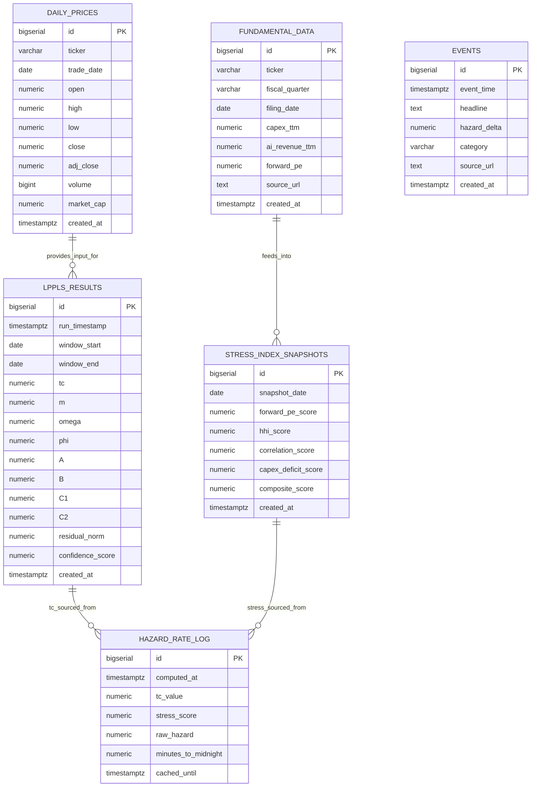

# Database Schema
### AI Bubble Doomsday Clock

> **Document status**: Approved — Source of Truth
> **Version**: 1.0.0
> **Last updated**: 2026-09-17
> **Database**: PostgreSQL 16
> **Migration tool**: Sequential versioned SQL files in `/migrations/`

---

## 1. Entity-Relationship Diagram



---

## 2. PostgreSQL Table Specifications

### 2.1 `daily_prices`

Stores rolling adjusted closing price and market cap data for the AI basket. Partitioned by year for query efficiency.

```
Table: daily_prices

Column         Type                Nullable  Default            Description
─────────────────────────────────────────────────────────────────────────────────────
id             BIGSERIAL           NOT NULL  AUTO               Primary key
ticker         VARCHAR(10)         NOT NULL                     Stock ticker symbol (e.g., "NVDA")
trade_date     DATE                NOT NULL                     Trading day (NYSE calendar)
open           NUMERIC(12, 4)      NOT NULL                     Opening price (USD)
high           NUMERIC(12, 4)      NOT NULL                     Daily high (USD)
low            NUMERIC(12, 4)      NOT NULL                     Daily low (USD)
close          NUMERIC(12, 4)      NOT NULL                     Closing price (USD)
adj_close      NUMERIC(12, 4)      NOT NULL                     Dividend/split-adjusted close (USD)
volume         BIGINT              NOT NULL                     Shares traded
market_cap     NUMERIC(20, 2)      NULL                         Market capitalization (USD); NULL if unavailable
created_at     TIMESTAMPTZ         NOT NULL  NOW()              Row insertion timestamp
```

**Indexes**:
```sql
-- Uniqueness constraint: one row per ticker per day
UNIQUE INDEX ux_daily_prices_ticker_date ON daily_prices (ticker, trade_date);

-- Fast range scans for LPPLS 500-day windows
INDEX idx_daily_prices_ticker_date ON daily_prices (ticker, trade_date DESC);

-- BRIN index for large partition scans (low overhead, good for time-series)
BRIN INDEX brin_daily_prices_trade_date ON daily_prices (trade_date);
```

**Partitioning**:
```
PARTITION BY RANGE (trade_date)
  PARTITION daily_prices_2022 FOR VALUES FROM ('2022-01-01') TO ('2023-01-01')
  PARTITION daily_prices_2023 FOR VALUES FROM ('2023-01-01') TO ('2024-01-01')
  PARTITION daily_prices_2024 FOR VALUES FROM ('2024-01-01') TO ('2025-01-01')
  PARTITION daily_prices_2025 FOR VALUES FROM ('2025-01-01') TO ('2026-01-01')
  PARTITION daily_prices_2026 FOR VALUES FROM ('2026-01-01') TO ('2027-01-01')
  PARTITION daily_prices_default DEFAULT
```

**Tracked tickers (AI Basket)**:

| Ticker | Company | Rationale |
|--------|---------|-----------|
| NVDA | NVIDIA | GPU monopoly for AI training |
| MSFT | Microsoft | Azure + OpenAI investment |
| AMZN | Amazon | AWS + Bedrock + CapEx leader |
| GOOGL | Alphabet | GCP + Gemini + TPU investment |
| META | Meta | LLaMA + compute infrastructure |
| TSLA | Tesla | Dojo supercomputer + FSD AI |
| AMD | AMD | Alternative GPU supplier (Instinct) |

**Upsert behavior**: `ON CONFLICT (ticker, trade_date) DO UPDATE SET adj_close = EXCLUDED.adj_close, market_cap = EXCLUDED.market_cap, created_at = NOW()`

---

### 2.2 `fundamental_data`

Stores quarterly CapEx, AI revenue, and forward P/E data from SEC 10-Q filings. Updated manually or via quarterly trigger.

```
Table: fundamental_data

Column              Type             Nullable  Default  Description
──────────────────────────────────────────────────────────────────────────────────────────
id                  BIGSERIAL        NOT NULL  AUTO     Primary key
ticker              VARCHAR(10)      NOT NULL           Stock ticker
fiscal_quarter      VARCHAR(6)       NOT NULL           Fiscal quarter identifier (e.g., "2026Q2")
filing_date         DATE             NOT NULL           Date of SEC 10-Q filing
capex_ttm           NUMERIC(20, 2)   NOT NULL           Cash CapEx — trailing 12 months (USD)
ai_revenue_ttm      NUMERIC(20, 2)   NULL               AI-attributable operating revenue — TTM (USD)
                                                        NULL if not separately disclosed
forward_pe          NUMERIC(10, 4)   NULL               Forward P/E ratio as of filing date
                                                        Sourced from consensus analyst estimates
source_url          TEXT             NOT NULL           Direct URL to SEC filing
created_at          TIMESTAMPTZ      NOT NULL  NOW()    Row insertion timestamp
```

**Indexes**:
```sql
-- One row per company per quarter
UNIQUE INDEX ux_fundamental_ticker_quarter ON fundamental_data (ticker, fiscal_quarter);

-- Efficient latest-quarter lookup
INDEX idx_fundamental_ticker_date ON fundamental_data (ticker, filing_date DESC);
```

**Reference data (2026 estimates)**:

| Ticker | 2026 Cash CapEx (TTM est.) | AI Rev Attribution |
|--------|--------------------------|-------------------|
| AMZN | $220,000,000,000 | AWS AI services |
| GOOGL | $200,000,000,000 | GCP + TPU infra |
| MSFT | $80,000,000,000 | Azure AI + OpenAI |
| META | $65,000,000,000 | Llama infra + DC |

---

### 2.3 `lppls_results`

Stores the output of each LPPLS regression run. One row per daily pipeline execution.

```
Table: lppls_results

Column           Type             Nullable  Default  Description
────────────────────────────────────────────────────────────────────────────────────────
id               BIGSERIAL        NOT NULL  AUTO     Primary key
run_timestamp    TIMESTAMPTZ      NOT NULL           When the regression was run
window_start     DATE             NOT NULL           First date in the price window
window_end       DATE             NOT NULL           Last date in the price window (most recent trade day)
tc               NUMERIC(14, 8)   NOT NULL           Critical time as decimal year (e.g., 2027.33012345)
m                NUMERIC(8, 6)    NOT NULL           Growth exponent; must satisfy 0.1 < m < 0.9
omega            NUMERIC(8, 4)    NOT NULL           Log-periodic frequency; must satisfy 4 < ω < 25
phi              NUMERIC(10, 8)   NOT NULL           Phase parameter [0, 2π)
A                NUMERIC(14, 6)   NOT NULL           Price level at singularity (> 0)
B                NUMERIC(14, 6)   NOT NULL           Amplitude coefficient (< 0, enforced)
C1               NUMERIC(14, 8)   NOT NULL           B·cos(φ) — linear decomposition
C2               NUMERIC(14, 8)   NOT NULL           B·sin(φ) — linear decomposition
residual_norm    NUMERIC(14, 10)  NOT NULL           L2 norm of fit residuals; lower = better fit
confidence_score NUMERIC(6, 4)    NOT NULL           Fit quality score [0, 1]; 1 - (residual/baseline)
created_at       TIMESTAMPTZ      NOT NULL  NOW()    Row insertion timestamp
```

**Constraints (enforced at DB level as CHECK constraints)**:
```sql
CONSTRAINT chk_lppls_m     CHECK (m > 0.1 AND m < 0.9)
CONSTRAINT chk_lppls_omega CHECK (omega > 4.0 AND omega < 25.0)
CONSTRAINT chk_lppls_B     CHECK (B < 0.0)
CONSTRAINT chk_lppls_A     CHECK (A > 0.0)
CONSTRAINT chk_lppls_conf  CHECK (confidence_score >= 0.0 AND confidence_score <= 1.0)
```

**Indexes**:
```sql
-- Latest run lookup (used by /api/v1/model)
INDEX idx_lppls_run_timestamp ON lppls_results (run_timestamp DESC);
```

---

### 2.4 `stress_index_snapshots`

Stores daily snapshots of the macro stress index and all four sub-component scores.

```
Table: stress_index_snapshots

Column                Type           Nullable  Default  Description
─────────────────────────────────────────────────────────────────────────────────────────
id                    BIGSERIAL      NOT NULL  AUTO     Primary key
snapshot_date         DATE           NOT NULL           Trading date of this snapshot
forward_pe_score      NUMERIC(6, 2)  NOT NULL           S_PE sub-score [0.00, 100.00]
hhi_score             NUMERIC(6, 2)  NOT NULL           S_HHI sub-score [0.00, 100.00]
correlation_score     NUMERIC(6, 2)  NOT NULL           S_corr sub-score [0.00, 100.00]
capex_deficit_score   NUMERIC(6, 2)  NOT NULL           S_CapEx sub-score [0.00, 100.00]
composite_score       NUMERIC(6, 2)  NOT NULL           Weighted composite [0.00, 100.00]
                                                        = 0.25 × (S_PE + S_HHI + S_corr + S_CapEx)
created_at            TIMESTAMPTZ    NOT NULL  NOW()    Row insertion timestamp
```

**Constraints**:
```sql
CONSTRAINT chk_stress_pe    CHECK (forward_pe_score   BETWEEN 0 AND 100)
CONSTRAINT chk_stress_hhi   CHECK (hhi_score          BETWEEN 0 AND 100)
CONSTRAINT chk_stress_corr  CHECK (correlation_score  BETWEEN 0 AND 100)
CONSTRAINT chk_stress_capex CHECK (capex_deficit_score BETWEEN 0 AND 100)
CONSTRAINT chk_stress_comp  CHECK (composite_score    BETWEEN 0 AND 100)
```

**Indexes**:
```sql
UNIQUE INDEX ux_stress_snapshot_date ON stress_index_snapshots (snapshot_date);
INDEX idx_stress_snapshot_date ON stress_index_snapshots (snapshot_date DESC);
```

---

### 2.5 `hazard_rate_log`

Immutable audit log of every hazard rate computation. Used for historical charting and the `/api/v1/history` endpoint.

```
Table: hazard_rate_log

Column               Type             Nullable  Default  Description
──────────────────────────────────────────────────────────────────────────────────────────
id                   BIGSERIAL        NOT NULL  AUTO     Primary key
computed_at          TIMESTAMPTZ      NOT NULL           When this hazard was computed
tc_value             NUMERIC(14, 8)   NOT NULL           tc used in this computation (decimal year)
stress_score         NUMERIC(6, 2)    NOT NULL           Composite stress score used [0, 100]
t_prox               NUMERIC(8, 6)    NOT NULL           Temporal proximity score [0, 1]
raw_hazard           NUMERIC(8, 6)    NOT NULL           H_raw = T_prox × stress_score/100 [0, 1]
sigmoid_hazard       NUMERIC(8, 6)    NOT NULL           H_sigmoid after logistic mapping [0, 1]
minutes_to_midnight  NUMERIC(6, 2)    NOT NULL           60 × sigmoid_hazard [0.00, 60.00]
data_quality         VARCHAR(20)      NOT NULL  'full'   "full" | "degraded" | "stale"
cached_until         TIMESTAMPTZ      NOT NULL           When the Redis cache for this entry expires
created_at           TIMESTAMPTZ      NOT NULL  NOW()    Row insertion timestamp
```

**Indexes**:
```sql
INDEX idx_hazard_computed_at ON hazard_rate_log (computed_at DESC);
INDEX idx_hazard_date ON hazard_rate_log (DATE(computed_at) DESC);
```

---

### 2.6 `events`

Curated event log for the Live Event Ticker (F-008). Manually inserted for MVP.

```
Table: events

Column       Type            Nullable  Default  Description
──────────────────────────────────────────────────────────────────────────────────
id           BIGSERIAL       NOT NULL  AUTO     Primary key
event_time   TIMESTAMPTZ     NOT NULL           When the real-world event occurred
headline     TEXT            NOT NULL           Short headline (max 120 chars)
hazard_delta NUMERIC(6, 2)   NULL               Change in minutes_to_midnight at event time
                                                 Negative = clock moved closer to midnight
category     VARCHAR(30)     NOT NULL           "earnings" | "capex_announcement" | "regulation"
                                                 | "model_release" | "crash" | "correction"
source_url   TEXT            NULL               URL to primary source article
created_at   TIMESTAMPTZ     NOT NULL  NOW()    Row insertion timestamp
```

**Indexes**:
```sql
INDEX idx_events_time ON events (event_time DESC);
INDEX idx_events_category ON events (category);
```

---

## 3. Migration Strategy

### 3.1 Migration File Convention

```
/migrations/
  001_init_schema.sql           — Initial tables: daily_prices, fundamental_data
  002_lppls_results.sql         — lppls_results table
  003_stress_snapshots.sql      — stress_index_snapshots table
  004_hazard_log.sql            — hazard_rate_log table
  005_events.sql                — events table
  006_partitioning.sql          — Apply date-range partitioning to daily_prices
  007_check_constraints.sql     — ADD CHECK constraints to lppls_results
```

### 3.2 Migration Rules

- **Sequential**: Migrations are numbered and run in order. Never renumber.
- **Additive only**: Never `DROP COLUMN` or `ALTER COLUMN TYPE` in a migration without a corresponding data migration.
- **Rollback section**: Every migration file must end with a commented `-- ROLLBACK:` section showing the inverse operations.
- **Never raw DDL in application code**: All schema changes go through migration files only.

### 3.3 Example Migration Format

```sql
-- 001_init_schema.sql
-- Description: Create initial daily_prices and fundamental_data tables
-- Created: 2026-09-17

BEGIN;

CREATE TABLE IF NOT EXISTS daily_prices (
  id          BIGSERIAL PRIMARY KEY,
  ticker      VARCHAR(10) NOT NULL,
  trade_date  DATE NOT NULL,
  -- ... (full DDL as specified above)
);

CREATE UNIQUE INDEX ux_daily_prices_ticker_date ON daily_prices (ticker, trade_date);

COMMIT;

-- ROLLBACK:
-- DROP TABLE IF EXISTS daily_prices CASCADE;
```

---

## 4. Redis Key Schema

### 4.1 Key Inventory

| Key Pattern | Type | TTL | Description |
|-------------|------|-----|-------------|
| `hazard:current` | JSON string | 86400s (24h) | Current computed hazard rate payload |
| `hazard:history:{YYYY-MM-DD}` | JSON string | 2592000s (30d) | Daily snapshot for history endpoint |
| `ratelimit:{ip_address}` | Counter (INCR) | 60s | Rate limiting sliding window |
| `og:image:{hash}` | Binary (bytes) | 3600s (1h) | Cached OG image PNG |

### 4.2 Key Value Schemas

**`hazard:current`** (JSON):
```json
{
  "minutes_to_midnight": 23.4,
  "hazard_rate":         0.71,
  "tc_date":             "2027-03-12",
  "tc_decimal":          2027.192,
  "stress_score":        68.2,
  "raw_hazard":          0.682,
  "sigmoid_hazard":      0.39,
  "data_quality":        "full",
  "updated_at":          "2026-09-17T22:01:34Z",
  "cache_ttl":           86400
}
```

**`hazard:history:{YYYY-MM-DD}`** (JSON):
```json
{
  "date":                "2026-09-17",
  "minutes_to_midnight": 23.4,
  "stress_score":        68.2,
  "tc_date":             "2027-03-12"
}
```

### 4.3 Cache Invalidation Rules

| Event | Keys Invalidated |
|-------|----------------|
| Daily pipeline completes | `hazard:current` |
| Quarterly fundamental update | `hazard:current` |
| OG image TTL expires | `og:image:{hash}` (auto-expired, not actively deleted) |

**Cache write-through pattern**: The Node API always writes to PostgreSQL first, then writes to Redis. It never writes to Redis without a successful DB commit.

---

## 5. Query Reference

### 5.1 Fetch 500 Trading Days of NDX Adjusted Close (for LPPLS)
```
SELECT trade_date, adj_close
FROM daily_prices
WHERE ticker = '^NDX'           -- or weighted composite of basket
  AND trade_date >= CURRENT_DATE - INTERVAL '700 days'
ORDER BY trade_date ASC
LIMIT 500;
```

### 5.2 Latest Stress Snapshot
```
SELECT *
FROM stress_index_snapshots
ORDER BY snapshot_date DESC
LIMIT 1;
```

### 5.3 Historical Hazard Rate (last 90 days)
```
SELECT DATE(computed_at) AS date,
       AVG(minutes_to_midnight) AS minutes_to_midnight,
       AVG(stress_score) AS stress_score
FROM hazard_rate_log
WHERE computed_at >= NOW() - INTERVAL '90 days'
GROUP BY DATE(computed_at)
ORDER BY date ASC;
```

---

*See also*: [docs/05-architecture.md](05-architecture.md) | [docs/07-api-specification.md](07-api-specification.md)
