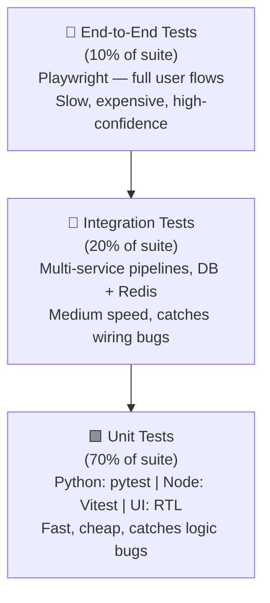

# Testing Strategy
### AI Bubble Doomsday Clock

> **Document status**: Approved — Source of Truth
> **Version**: 1.0.0
> **Last updated**: 2026-09-17

---

## 1. Test Philosophy & Pyramid

The testing strategy follows a **risk-weighted pyramid** where the base layer (unit tests) catches the majority of bugs cheaply, while higher layers verify integration and user-visible behavior. The mathematical engine receives the highest coverage requirement because errors there directly corrupt the clock's scientific credibility.



**Coverage targets** (CI gates — build fails if below threshold):

| Service | Framework | Coverage Target |
|---------|----------|----------------|
| Python Math Engine | pytest + coverage.py | **≥ 95%** |
| Node.js API | Vitest | **≥ 85%** |
| Next.js Frontend | Jest + React Testing Library | **≥ 80%** |

---

## 2. Unit Tests

### 2.1 Python Math Engine

**Framework**: `pytest` + `pytest-cov`
**Location**: `services/python-engine/tests/`
**Run command**: `pytest services/python-engine --cov=app --cov-fail-under=95 -v`

#### Test Suite: LPPLS OLS Design Matrix (`test_design_matrix.py`)

| Test | Inputs | Expected Output | Rationale |
|------|--------|----------------|-----------|
| `test_design_matrix_shape` | 100 prices, tc=2027.0, m=0.5, ω=10 | X.shape == (100, 3) | Verify 3-column design matrix |
| `test_design_matrix_dtype` | — | X.dtype == np.float64 | Ensure no precision loss |
| `test_design_matrix_column_zero` | — | X[:, 0] == np.ones(100) | Bias column must be all ones |
| `test_design_matrix_tc_in_future` | tc < max(dates) | ValueError raised | tc must be after last data point |

#### Test Suite: LPPLS Solver (`test_solver.py`)

| Test | Description | Pass Criterion |
|------|-------------|---------------|
| `test_synthetic_parameter_recovery` | Generate series with known params; solve; compare | `\|tc_hat - tc_true\| < 0.05 years`; `\|m_hat - m_true\| < 0.05`; `\|ω_hat - ω_true\| < 0.5` |
| `test_solver_determinism` | Call `solve_lppls()` twice with identical input | `result_1 == result_2` — bit-for-bit identical |
| `test_solver_bound_m_respected` | Run on real-shape data | `0.1 < m < 0.9` always |
| `test_solver_bound_omega_respected` | — | `4.0 < omega < 25.0` always |
| `test_solver_B_negative` | — | `B < 0.0` always |
| `test_solver_minimum_input_length` | prices array of length 99 | Raises `ValidationError` with message about minimum 100 points |
| `test_solver_flat_price_array` | prices = [1.0] × 100 | Returns result without crashing; residual_norm is high |
| `test_solver_nan_in_prices` | prices array with NaN | Raises `ValidationError` |
| `test_solver_non_ascending_dates` | Dates out of order | Raises `ValidationError` |
| `test_confidence_score_range` | Any valid input | `0.0 ≤ confidence_score ≤ 1.0` |

#### Test Suite: FastAPI Endpoints (`test_api.py`)

| Test | Endpoint | Scenario | Expected |
|------|---------|---------|---------|
| `test_solve_valid_input` | `POST /solve` | 500 prices + dates | 200 OK; valid LPPLSResult JSON |
| `test_solve_too_few_prices` | `POST /solve` | 50 prices | 422; `"Insufficient data"` message |
| `test_solve_mismatched_lengths` | `POST /solve` | prices length ≠ dates length | 422 |
| `test_solve_negative_price` | `POST /solve` | price = -1.0 in array | 422 |
| `test_health` | `GET /health` | — | 200; `{"status": "ok"}` |

#### Test Suite: Purity Enforcement (`test_purity.py`)

Automated test that parses AST of all Python engine source files and asserts no import of forbidden modules:

```python
FORBIDDEN_IMPORTS = [
    "sqlalchemy", "psycopg2", "pymongo", "asyncpg",  # database
    "requests", "httpx", "aiohttp", "urllib",         # HTTP clients
    "boto3", "google.cloud",                          # cloud SDKs
]
```

---

### 2.2 Node.js API

**Framework**: `Vitest`
**Location**: `services/api/src/**/*.test.ts`
**Run command**: `npm run test -- --coverage --coverage.threshold.global.lines=85`

#### Test Suite: Stress Index Calculators (`stress/*.test.ts`)

| Test | Function | Inputs | Expected |
|------|---------|--------|---------|
| `PE score — known values` | `calcPEScore` | PE=45, fair=20, max=50 | 83.33 |
| `PE score — at fair value` | `calcPEScore` | PE=20, fair=20, max=50 | 0.00 |
| `PE score — above max` | `calcPEScore` | PE=60, fair=20, max=50 | 100.00 (clamped) |
| `HHI — equal shares` | `calcHHI` | [0.25, 0.25, 0.25, 0.25] | 0.25 |
| `HHI score — known value` | `calcHHIScore` | hhi=0.30 | 55.56 |
| `Correlation score — zero corr` | `calcCorrelationScore` | returns 0.0 mean ρ | 0.00 |
| `Correlation score — clamped` | `calcCorrelationScore` | all stocks identical | 100.00 |
| `CapEx deficit — known ratio` | `calcCapExScore` | D=3.5, base=0.5, max=5.0 | 66.67 |
| `Composite — known all scores` | `calcCompositeStress` | [83.33, 55.56, 75.0, 66.67] | 70.14 |
| `Composite — all zero` | `calcCompositeStress` | [0, 0, 0, 0] | 0.00 |
| `Composite — all max` | `calcCompositeStress` | [100, 100, 100, 100] | 100.00 |

#### Test Suite: Hazard Rate Synthesizer (`hazard/*.test.ts`)

| Test | Scenario | Expected |
|------|---------|---------|
| `T_prox — tc exactly 1 year away` | tc = now + 1yr | T_prox = 0.5 |
| `T_prox — tc in the past` | tc < now | T_prox = 1.0 (clamped) |
| `T_prox — tc > 2 years away` | tc = now + 3yr | T_prox = 0.0 |
| `H_raw — maximum risk` | T_prox=1.0, stress=100 | H_raw = 1.0 |
| `H_raw — zero risk` | T_prox=0.0, stress=100 | H_raw = 0.0 |
| `Sigmoid — midpoint` | H_raw=0.55, k=12, H0=0.55 | H_sigmoid ≈ 0.5 |
| `Minutes — known case` | H_sigmoid = 0.39 | minutes = 23.4 |
| `Minutes — range check` | Any valid input | minutes ∈ [0, 60] |

#### Test Suite: Redis Cache Layer (`cache/*.test.ts`)

Uses `ioredis-mock` for unit tests:

| Test | Scenario | Expected |
|------|---------|---------|
| `cache hit` | Key exists | Returns parsed JSON; `X-Cache: HIT` |
| `cache miss` | Key absent | Returns null; caller falls back to DB |
| `stale detection` | `updated_at` > 26h ago | `data_quality: "stale"` in response |
| `cache write` | Pipeline success | `SET hazard:current {...} EX 86400` called |
| `cache invalidation` | Before pipeline write | `DEL hazard:current` called |

#### Test Suite: Zod Schema Validation (`middleware/*.test.ts`)

| Test | Endpoint | Invalid Input | Expected |
|------|---------|-------------|---------|
| `history range validation` | `GET /history` | `?range=5m` | 422; allowed values listed |
| `events limit validation` | `GET /events` | `?limit=-1` | 422 |
| `trigger type validation` | `POST /admin/trigger-pipeline` | `{type: "weekly"}` | 422 |
| `admin auth check` | `POST /admin/trigger-pipeline` | No Bearer token | 401 |

---

### 2.3 Next.js Frontend

**Framework**: `Jest` + `React Testing Library`
**Location**: `apps/web/src/**/*.test.tsx`
**Run command**: `npm run test:ui -- --coverage`

#### Test Suite: ClockFace Component

| Test | Scenario | Expected |
|------|---------|---------|
| `renders at 23 minutes` | `minutes={23}` | SVG hand `transform` = `rotate(138deg)` (23/60 × 360 − 90) |
| `renders at 0 minutes` | `minutes={0}` | Hand at 12 o'clock position (`rotate(-90deg)`) |
| `renders at 60 minutes` | `minutes={60}` | Hand completes full circle |
| `critical color at 10 min` | `minutes={10}` | `--clock-accent` = `#EF3535` |
| `warning color at 20 min` | `minutes={20}` | `--clock-accent` = `#F59E0B` |
| `safe color at 50 min` | `minutes={50}` | `--clock-accent` = `#22C55E` |
| `aria-label updates` | `minutes={23}` | `aria-label` contains "23 minutes" |
| `shows loading skeleton` | `isLoading={true}` | Skeleton element rendered; clock SVG absent |
| `shows stale banner` | `isStale={true}` | Banner with `last_updated` timestamp visible |
| `reduced motion` | `prefers-reduced-motion` media | No animation CSS applied |

#### Test Suite: MathDrawer Component

| Test | Scenario | Expected |
|------|---------|---------|
| `closed by default` | Initial render | Drawer not visible; `aria-expanded="false"` |
| `opens on button click` | Click "View the Math" | Drawer visible; `aria-expanded="true"` |
| `closes on backdrop click` | Click outside drawer | Drawer hidden |
| `renders LPPLS params` | Mock API response provided | tc date, m, ω, φ all visible |
| `renders stress sub-scores` | Mock API response | 4 sub-score rows with values |
| `download JSON` | Click "Download JSON" | `URL.createObjectURL` called; `<a>` click triggered |
| `fetches on first open only` | Open, close, open | API called exactly once |

---

## 3. Integration Tests

**Location**: `tests/integration/`
**Run command**: `docker compose -f docker-compose.test.yml run integration`

Uses a real PostgreSQL and Redis instance in a test Docker Compose network.

### 3.1 Full Daily Pipeline Integration

**Scenario**: Mock yfinance data → full pipeline → verify database state and Redis cache

```
Test: test_daily_pipeline_end_to_end

Setup:
  - Start test Postgres + Redis containers
  - Load 500 rows of historical OHLCV fixtures into daily_prices
  - Load fundamental_data fixtures

Execute:
  - Call runDailyPipeline() (with yfinance mocked to return fixtures)

Assert:
  - lppls_results has 1 new row with run_timestamp within last 5 seconds
  - lppls_results.m is in (0.1, 0.9)
  - lppls_results.B < 0
  - stress_index_snapshots has 1 new row
  - stress_index_snapshots.composite_score is in [0, 100]
  - hazard_rate_log has 1 new row
  - Redis GET hazard:current returns valid JSON
  - JSON updated_at is within last 5 seconds
  - JSON minutes_to_midnight is in [0, 60]
```

### 3.2 Database Migration Cycle

```
Test: test_migration_up_down

Execute:
  - Run all migrations UP against empty test database
  - Assert all 6 tables exist
  - Assert all CHECK constraints exist (using pg_constraint)
  - Run all migrations DOWN
  - Assert all tables are dropped
```

### 3.3 Python Engine HTTP Contract

```
Test: test_python_engine_http_contract

Setup:
  - Start python-engine container

Execute:
  - POST /solve with 500 synthetic prices

Assert:
  - Status 200
  - Response matches LPPLSResult schema exactly
  - tc > current decimal year
  - m in (0.1, 0.9)
  - omega in (4, 25)
  - B < 0
  - confidence_score in [0, 1]

Execute:
  - POST /solve with 50 prices (too few)

Assert:
  - Status 422
  - Error message contains "100"
```

### 3.4 Redis Cache Invalidation

```
Test: test_cache_invalidation_on_pipeline_run

Setup:
  - Pre-populate hazard:current with stale data (updated_at 48h ago)

Execute:
  - Run daily pipeline

Assert:
  - After pipeline: GET hazard:current has updated_at < 60s ago
  - Old stale data is no longer present
```

---

## 4. End-to-End Tests (Playwright)

**Framework**: Playwright
**Location**: `tests/e2e/`
**Run command**: `npx playwright test`
**Environment**: Full Docker Compose stack with test fixtures

### 4.1 Landing Page Load

```
Scenario: First-time visitor sees clock

Given I navigate to http://localhost:3000
When the page loads
Then the clock SVG is visible within 3 seconds (LCP < 3s)
And the text "min to midnight" is visible
And no JavaScript errors appear in the console
And the page title contains "AI Bubble Doomsday Clock"
```

### 4.2 Math Drawer Interaction

```
Scenario: Quant researcher opens the math drawer

Given I navigate to http://localhost:3000
When I click the button with text "View the Math"
Then the math drawer slides into view within 500ms
And I see a table containing "tc"
And I see a row containing "m"
And I see a row containing "omega" or "ω"
And I see text containing "confidence"

When I click the "Download JSON" button
Then a file download is triggered
```

### 4.3 Social Share OG Image

```
Scenario: OG image generates correctly

Given I make a GET request to /api/v1/og-image?theme=dark
Then the response status is 200
And the Content-Type is image/png
And the response body length is > 10000 bytes (non-trivial image)
```

### 4.4 Mobile Responsive Layout

```
Scenario: Mobile user at 375px

Given Playwright viewport is set to 375×812 (iPhone 14)
When I navigate to http://localhost:3000
Then no horizontal scrollbar appears
And the clock SVG has width ≤ 340px
And the "View the Math" button is visible without scrolling
And clicking "View the Math" opens a full-screen bottom drawer
```

### 4.5 Error State Handling

```
Scenario: API is unreachable

Given the Node API container is stopped
When I navigate to http://localhost:3000
Then the page does not throw a 500 error
And a user-visible error message appears (e.g., "Unable to load clock data")
And the page title is still correct
```

---

## 5. Performance Tests

**Framework**: k6
**Location**: `tests/performance/`
**Run command**: `k6 run tests/performance/clock_endpoint.js`

### 5.1 Sustained Load — Clock Endpoint

```javascript
// k6 scenario: sustained 1000 req/s for 5 minutes
// Target: p95 < 200ms, error rate < 0.1%

Target endpoint: GET /api/v1/clock
VUs:            100
Rate:           1000 req/s (10 req/VU/s)
Duration:       5 minutes
Pass criteria:
  - http_req_duration p(95) < 200ms
  - http_req_failed rate < 0.001 (0.1%)
  - X-Cache: HIT on > 99% of requests (Redis serving)
```

### 5.2 Spike Test — Viral Traffic Simulation

```javascript
// k6 scenario: simulate a viral Reddit post
// 0 → 10,000 req/s ramp over 30 seconds, sustain for 2 minutes, ramp down

Stages:
  { duration: "30s", target: 500 }    // ramp to 500 VUs
  { duration: "2m",  target: 500 }    // sustain
  { duration: "30s", target: 0 }      // ramp down

Pass criteria:
  - System recovers (no error state) during ramp
  - No data corruption in Redis during spike
  - Error rate < 1% at peak load
```

### 5.3 LPPLS Solver Latency

```javascript
// Single-threaded load on Python engine

Target endpoint: POST /solve (with 500 real prices)
VUs:            5 (simulate 5 concurrent pipeline runs)
Iterations:     20

Pass criteria:
  - p50 < 2000ms
  - p99 < 10000ms
  - 0% error rate
```

---

## 6. Mathematical Validation Tests

These tests exist in `tests/mathematical/` and are run manually (not in CI by default) due to long run times. They validate model accuracy against historical reality.

### 6.1 Historical Backtesting Suite

| Dataset | Period | Known event | Pass criterion |
|---------|--------|------------|----------------|
| Nasdaq-100 2000 dot-com | Jan 1998 – Mar 2000 | Peak: Mar 10, 2000 | $\hat{t}_c$ within ±30 trading days |
| S&P 500 2008 GFC | Jan 2006 – Sep 2008 | Peak: Oct 9, 2007 | $\hat{t}_c$ within ±30 trading days |
| Nasdaq-100 2021 meme bubble | Jan 2020 – Nov 2021 | Peak: Nov 19, 2021 | $\hat{t}_c$ within ±30 trading days |

**Run command**: `python tests/mathematical/backtest_lppls.py --dataset all --verbose`

### 6.2 Stress Index Correlation with VIX

Compute historical stress index on overlapping date windows and measure Pearson correlation with realized VIX:

```
Pass criterion: Pearson r > 0.70 over 2018–2026 backtesting window
```

**Run command**: `python tests/mathematical/stress_vix_correlation.py`

### 6.3 Residual Analysis

Verify the LPPLS fit residuals on real NDX data are approximately normally distributed (evidence of good model specification):

```
Pass criterion:
  - Shapiro-Wilk p-value > 0.05 (residuals approximately normal)
  - No autocorrelation in residuals (Durbin-Watson statistic 1.5 < DW < 2.5)
```

---

## 7. CI/CD Integration

### 7.1 GitHub Actions Pipeline

**Trigger**: Every pull request; every push to `main`

```yaml
Pipeline stages (sequential):
  1. python-lint:        ruff check services/python-engine
  2. python-typecheck:   mypy --strict services/python-engine
  3. python-test:        pytest --cov --cov-fail-under=95
  4. python-purity:      pytest tests/test_purity.py (forbidden imports)
  5. node-lint:          npm run lint
  6. node-typecheck:     npm run type-check
  7. node-test:          npm run test -- --coverage
  8. frontend-test:      npm run test:ui -- --coverage
  9. docker-build:       docker compose build (all images)
  10. integration-test:  docker compose -f docker-compose.test.yml run integration
  (E2E runs nightly only, not on every PR — too slow)
```

### 7.2 Branch Protection Rules

| Rule | Setting |
|------|---------|
| Require status checks | All 10 pipeline stages must pass |
| Require branches up to date | Enabled (no stale PRs) |
| Dismiss stale reviews | Enabled |
| Require linear history | Enabled (squash merge only) |

### 7.3 Coverage Reporting

Coverage reports uploaded to artifact storage on every run. PRs display a coverage diff comment showing line-by-line changes to coverage.

---

*See also*: [docs/02-features.md](02-features.md) | [docs/09-development-plan.md](09-development-plan.md) | [docs/07-api-specification.md](07-api-specification.md)
